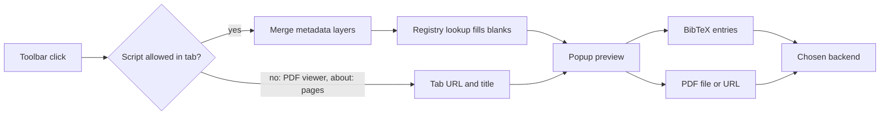

# How it works

The addon has no background script and no always-on content script. When you click the toolbar button, the popup injects one script into the active tab, gets the extracted metadata back, and fills any gaps from public registries.

## Metadata layers

Each layer can supply any field. Layers are merged field by field, and the first one with a value wins. The addon records which layer gave each field.

| Order | Layer | Reads |
|---|---|---|
| 1 | arXiv | Rules for `arxiv.org` pages |
| 2 | Highwire | `citation_*` meta tags |
| 3 | bepress | `bepress_citation_*` meta tags |
| 4 | EPrints | EPrints meta tags |
| 5 | JSON-LD | `application/ld+json` blocks |
| 6 | Microdata | Schema.org microdata |
| 7 | COinS | A single COinS item. Several mean a list page |
| 8 | PRISM | `prism.*` meta tags |
| 9 | Dublin Core | Dublin Core meta tags |
| 10 | Web metadata | Open Graph, Twitter and plain meta tags |
| 11 | Identifier scan | DOI, arXiv id, PMID and PMCID from the URL, and ISBN from the page text |

If no layer gives a title, the addon uses the page's own title, then its URL. An item with no identifier and no stated type becomes a web page.

## Pages with several items

A page that identifies itself is treated as one item, whatever it cites. Otherwise, several COinS items and DOI links become choices in the popup.

A DOI found only in links might be a citation. When a page has up to three such DOIs, the addon looks them up and compares titles. A DOI whose registry title appears in the page's title is taken as the page's own.

## Registry lookup

With an identifier in hand, the addon asks these registries in order and stops at the first one that returns a title. Each request has an 8-second timeout, and a failed lookup adds nothing.

| Identifier | Registry | Host |
|---|---|---|
| DOI | Crossref, then DataCite | `api.crossref.org`, `api.datacite.org` |
| arXiv id | arXiv API | `export.arxiv.org` |
| PMID, PMCID | NCBI E-utilities | `eutils.ncbi.nlm.nih.gov` |

Values from the page stand, and the registry only fills blanks. There are four exceptions: a title that was only the page's fallback title, the item type, a January 1 date that the registry gives more exactly for the same year, and an arXiv id that gains its latest version.

The addon does no lookup for a full-page PDF. linXiv reads that file and checks the metadata itself.

## Full-page PDFs

Firefox refuses script injection in its PDF viewer, so the addon can't read the PDF open in the tab. On a server backend it requests the tab's URL again, then uploads the file. If the answer is a site's security check page, it opens the same URL in a background tab, where the check can run, and retries for about 15 seconds. If the check needs a person, you solve it yourself.

The addon never stores signed links, such as S3 links. It removes the whole query string from the saved URL.

## BibTeX

Metadata saves send BibTeX to every backend. The entry key decides identity in linXiv, so saving the same page again aims for the same record.

| Item has | Key |
|---|---|
| arXiv id | `arxiv:<id without version>` |
| DOI | `doi_<DOI>` |
| ISBN | `isbn_<ISBN>` |
| None of these | `web_<hash of the URL>` |

## Permissions

| Permission | Why |
|---|---|
| `activeTab`, `scripting` | Read the current tab when you click the button |
| `storage` | Keep your settings |
| Host access to the four registry hosts above | Look up identifiers |
| Optional access to any `http` or `https` site | Requested only for your server, in **Test connection**, and for a PDF's site, through **Allow and save** |

Firefox host permissions can't name a port, so access to a server covers every port on that host.

The manifest declares `browsingActivity` and `websiteContent` under `data_collection_permissions`, because page URLs and page content leave the browser for your server.

## What leaves your browser

| When | What | Where |
|---|---|---|
| The popup opens on a page with an identifier | That identifier | The registries above |
| You click **Save to linXiv** on a page | The BibTeX entries | Your backend |
| You click **Save to linXiv** on a PDF tab, server backend | A request for the PDF, with your session cookies, then the file | The PDF's site, then your server |
| You click **Save to linXiv** on a PDF tab, desktop app | The PDF's URL, unless it's signed | The desktop app |
| You run **Test connection** or save, server backend | Your token | Your server only |
